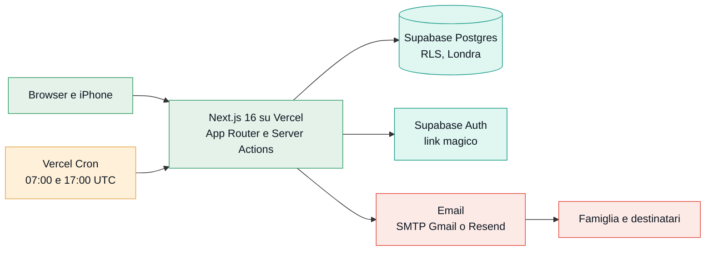

<div align="center">


# Panoramix

Un'app web per chi gestisce le medicine di un familiare.<br>
Dice quando va presa ogni compressa, tiene il conto delle scorte in casa<br>
e manda un'email quando una medicina va riordinata.

[](https://panoramix-rust.vercel.app)

[Accedi](https://panoramix-rust.vercel.app/accesso) · [Funzionalità](#funzionalità) · [Architettura](#architettura) · [Avvio in locale](#avvio-in-locale) · [Test](#test)


</div>

## Cosa fa

Per ogni familiare si crea un piano con le sue medicine, le dosi e gli orari. Da lì Panoramix calcola quante compresse restano in casa giorno per giorno, quanti giorni coprono e quando finiranno. Quando una medicina scende sotto una soglia parte un'email a chi se ne occupa, con il tempo di chiedere la ricetta e passare in farmacia.

Il piano si può condividere con altri familiari, ognuno con il proprio account. L'interfaccia è in italiano e funziona su telefono e computer, e si può aggiungere alla Home dell'iPhone.

Ogni medicina ha uno di quattro stati, con gli stessi colori dell'app:

| Stato | Quando |
| --- | --- |
|  | la scorta basta e nessuna soglia è scattata |
|  | è scattata una soglia attiva: meno di 14 giorni, meno di 7 giorni o ultima confezione |
|  | è stata segnata come ordinata e si aspetta l'arrivo |
|  | la scorta è finita o non basta per oggi |

> Panoramix è un promemoria: non dà consigli medici, non controlla le interazioni tra farmaci e non contatta medici o farmacie.

## Funzionalità

### Terapia e calendario

- Dosi per fascia (mattino, mezzogiorno, sera), anche mezze compresse.
- Frequenze: ogni giorno, in certi giorni della settimana, ogni N giorni, a cicli, con data di fine, oppure al bisogno.
- Cambi di dose programmati da una certa data, per terapie a scalare o sospensioni. Scorte, calendario e avvisi seguono la nuova dose dal giorno in cui parte.
- Calendario settimanale per fasce e foglio A4 da stampare o salvare in PDF.

### Scorte

- Due modi di contare: giorno per giorno, oppure con il portapillole settimanale, dove le compresse escono solo quando si segna «Portapillole preparato» (e l'operazione si può annullare).
- Un dispenser grafico mostra a colpo d'occhio quanto resta di ogni medicina, con lo storico di arrivi, conteggi e prese.
- Per i medicinali al bisogno il pulsante «Presa 1» scala le scorte e si può annullare.

### Avvisi e promemoria via email

- Un controllo al giorno manda al massimo un'email per piano, solo per le medicine che hanno appena superato una soglia.
- Promemoria del portapillole la sera prima della preparazione, con cosa mettere e cosa manca.
- Riepilogo del lunedì, facoltativo.
- Un'email di prova per verificare che i messaggi arrivino.

### Farmacia e documenti

- Lista per la farmacia con le confezioni suggerite per 30 giorni. Il testo si copia, si condivide o si manda su WhatsApp, e c'è anche la richiesta della ricetta al medico. Più medicine si segnano come ordinate in un colpo solo.
- Scheda terapia: un foglio A4 con la terapia in corso da portare a una visita o al pronto soccorso, stampabile o in PDF. Dall'app sulla Home dell'iPhone il PDF si condivide direttamente.

### Condivisione e account

- Il proprietario invita fino a 10 persone, in sola lettura o con permesso di modifica su scorte, portapillole e medicinali. Impostazioni, destinatari, persone con accesso ed eliminazione del piano restano al proprietario.
- Accesso con link magico via email, senza password.
- Tema automatico, chiaro o scuro.
- Eliminazione completa dei propri dati dalla pagina Account.

## Architettura



- Next.js 16 (App Router, Server Actions) e TypeScript, Tailwind CSS 4 con i token del design in `app/globals.css`.
- Supabase: Postgres, Auth con link magico e Row Level Security.
- Email con Nodemailer via SMTP Gmail, dietro l'interfaccia `EmailProvider` (`lib/email/provider.ts`). Con `EMAIL_PROVIDER=resend` si passa a Resend.
- Due Vercel Cron protetti da `CRON_SECRET`: avvisi alle 07:00 UTC su `/api/cron/alerts`, promemoria alle 17:00 UTC su `/api/cron/reminders`.
- Test con Vitest per la logica e le Server Actions, test sul database locale per le regole RLS, Playwright per il percorso nel browser.

### Dove gira cosa

| Parte | Servizio | Dove |
| --- | --- | --- |
| Pagine, Server Actions e route dei cron | Vercel Functions, piano Hobby | `fra1`, Francoforte (scelta in [`vercel.json`](vercel.json)) |
| Avvio dei controlli automatici | Vercel Cron, due volte al giorno | chiama le route qui sopra, quindi Francoforte |
| Database Postgres, Auth e link magico | Supabase, piano Free, progetto "Panoramix" | `eu-west-2`, Londra |
| Invio delle email (avvisi, inviti, link di accesso) | Gmail SMTP (`smtp.gmail.com`) | server di Google |
| Indirizzo pubblico | dominio predefinito di Vercel | [panoramix-rust.vercel.app](https://panoramix-rust.vercel.app) |

Funzioni e database sono in due regioni diverse, quindi ogni lettura o scrittura va da Francoforte a Londra e torna. Londra non è nell'Unione Europea. Per ora resta così; per avvicinarli si possono spostare le funzioni in `lhr1` (Londra) da `vercel.json`, oppure creare un nuovo progetto Supabase a Francoforte e migrarci i dati.

### Scelte tecniche

- Tutta la logica delle scorte sta in funzioni pure in `lib/forecast.ts` (dosi, fabbisogno, copertura, data di esaurimento, stato, soglie, portapillole, calendario), coperta da test che includono mezze compresse, cicli e cambio dell'ora legale.
- Le date sono date di calendario senza fuso orario; "oggi" si calcola sempre nel fuso Europe/Rome (`lib/dates.ts`).
- I movimenti di magazzino passano da funzioni SQL atomiche (`record_stock_event`, `apply_prep`, `undo_prep`), quindi una preparazione del portapillole si annulla esattamente.
- I permessi sono controllati due volte: le Server Actions verificano il ruolo e le regole RLS del database bloccano comunque ogni scrittura non permessa.
- I cron sono idempotenti: se girano due volte nello stesso giorno non partono email doppie (`alert_runs`, `notification_runs`).
- I cron leggono ogni tabella a pagine da 1000 righe, il massimo che Supabase restituisce per richiesta, senza mettere elenchi di identificativi nell'indirizzo. Controllano 5 piani alla volta e mandano le email su 3 connessioni SMTP riaperte una sola volta (`lib/batch.ts`, `lib/email/provider.ts`).
- Se un controllo automatico fallisce, o quello del giorno prima non è partito, arriva un'email tecnica a `OPS_ALERT_EMAIL`.

Il comportamento segue la specifica funzionale. L'aspetto viene dall'export di Claude Design in [`UI_mobile_pc/`](UI_mobile_pc): token, componenti, schermate per telefono e desktop, email e foglio A4.

## Struttura

| Percorso | Cosa contiene |
| --- | --- |
| `lib/forecast.ts` | Logica di dominio pura: dosi, fabbisogno, scorta attuale, copertura, esaurimento, stato, soglie ed episodi, portapillole, calendario |
| `lib/dates.ts` | Date di calendario senza fusi, "oggi" a Roma, formattazione in italiano |
| `lib/actions/` | Server Actions con validazione zod (accesso, piani, medicinali, scorte, email di prova) |
| `lib/alerts.ts` | Controllo giornaliero: episodi, un'email al giorno per piano, idempotenza |
| `lib/notify.ts` | Promemoria del portapillole e riepilogo settimanale (un invio al giorno per piano e tipo) |
| `lib/ops.ts` | Controllo saltato ed email tecnica a chi gestisce l'app |
| `lib/cron-data.ts` | Dati per i controlli automatici e destinatari di ogni piano |
| `lib/roles.ts` | Ruoli sul piano (proprietario, modifica, sola lettura) |
| `lib/pharmacy.ts` · `lib/digest.ts` | Lista per la farmacia, contenuto di promemoria e riepiloghi (funzioni pure) |
| `lib/email/` | `EmailProvider` (SMTP/Resend), avviso, invito, promemoria, riepilogo, email tecnica |
| `supabase/migrations/` | Schema, RLS e funzioni SQL versionate |
| `supabase/seed.sql` | Dati d'esempio, marcati `[ESEMPIO]` |
| `supabase/templates/magic-link.html` | Modello italiano dell'email con il link di accesso |
| `tests/` | Vitest: dominio, email, Server Actions (`tests/*.test.ts`); database locale (`tests/db`); browser con Playwright (`tests/e2e`) |
| `app/icon.svg` | Icona "Vischio di pillole", unica fonte del disegno. `node scripts/build-icons.mjs` rigenera `public/email-logo.png` e `app/apple-icon.png` |

### Pagine

`/accesso` · `/benvenuto` (nome e cognome al primo accesso) · `/piani` (con gli inviti ricevuti) · `/piani/nuovo` · `/piani/[id]` (dispenser) · `/piani/[id]/calendario` · `/piani/[id]/stampa` (A4) · `/piani/[id]/terapia` (scheda terapia A4) · `/piani/[id]/farmacia` · `/piani/[id]/modifica` (solo proprietario, con persone con accesso) · `/piani/[id]/medicinali/nuovo` · `/piani/[id]/medicinali/[medId]` (con cambi di dose) · `/piani/[id]/medicinali/[medId]/storico` · `/account` (con eliminazione dei dati).

Chi ha la sola lettura vede dispenser, calendario, storico, lista farmacia e scheda terapia; se apre una pagina di modifica torna al piano.

## Avvio in locale

Serve Node.js 20.9 o successivo.

```bash
npm install
cp .env.example .env.local   # poi compila i valori
npm run dev                  # http://localhost:3000
```

Per accedere in locale aggiungi `http://localhost:3000/**` tra i Redirect URLs di Supabase, oppure usa direttamente l'[app pubblicata](https://panoramix-rust.vercel.app).

### Supabase locale

È il modo consigliato per provare senza toccare i dati veri. Serve Docker. `supabase/config.toml` è già pronto: le migrazioni si applicano all'avvio e le email, link di accesso compresi, finiscono in Mailpit invece di partire.

```bash
npx supabase start          # Postgres, Auth e Mailpit in Docker
npx supabase status -o env  # URL e chiavi locali da copiare in .env.local
```

In `.env.local` usa `API_URL`, `ANON_KEY` e `SERVICE_ROLE_KEY` del Supabase locale, `SMTP_HOST=127.0.0.1`, `SMTP_PORT=54325` (utente e password qualsiasi) e `APP_URL=http://localhost:3000`. Le email si leggono su <http://127.0.0.1:54324>. `npx supabase db reset` riparte da zero; per i dati d'esempio vedi `supabase/seed.sql`.

<details>
<summary><b>Variabili d'ambiente</b></summary>

Sono tutte in [`.env.example`](.env.example). Nel repository non ci sono mai valori reali.

| Variabile | Dove si prende | Note |
| --- | --- | --- |
| `NEXT_PUBLIC_SUPABASE_URL` | Supabase → Project Settings → Data API | |
| `NEXT_PUBLIC_SUPABASE_ANON_KEY` | Supabase → Project Settings → API Keys | chiave publishable (o `anon` legacy) |
| `SUPABASE_SERVICE_ROLE_KEY` | Supabase → Project Settings → API Keys | chiave secret (o `service_role` legacy). Solo lato server, la usa solo il cron |
| `EMAIL_PROVIDER` | | `smtp` (default) oppure `resend` |
| `SMTP_HOST` / `SMTP_PORT` | | `smtp.gmail.com` / `465` |
| `SMTP_USER` | la casella Gmail | è anche il mittente reale |
| `SMTP_PASSWORD` | password per le app di Google | 16 caratteri, senza spazi |
| `MAIL_FROM_NAME` | | `Panoramix` |
| `RESEND_API_KEY`, `MAIL_FROM_ADDRESS` | resend.com | solo con `EMAIL_PROVIDER=resend` |
| `CRON_SECRET` | `openssl rand -hex 32` | Vercel lo manda come `Authorization: Bearer …` |
| `APP_URL` | l'indirizzo dell'app | es. `https://panoramix.vercel.app`, senza barra finale |
| `OPS_ALERT_EMAIL` | | chi riceve le email tecniche se un controllo automatico fallisce (default `bianchicarlo2002@icloud.com`) |

</details>

<details>
<summary><b>Database e migrazioni</b></summary>

Le migrazioni sono in `supabase/migrations/` e vanno applicate in ordine:

1. `…_schema.sql`: tabelle `profiles`, `plans`, `plan_recipients`, `medications`, `stock_events`, `prep_runs`, `alert_log`, `alert_runs`, `cron_runs`.
2. `…_rls.sql`: Row Level Security, ogni riga è raggiungibile solo dal proprietario del piano.
3. `…_functions.sql`: operazioni atomiche `record_stock_event`, `apply_prep`, `undo_prep`, `change_stock_mode`, `delete_my_account`.
4. `…_fk_indexes.sql`: indici sulle chiavi esterne `created_by`.
5. `…_sharing.sql`: piani condivisi con `plan_members` e `plan_invites` (massimo 10 persone per piano), le funzioni `plan_role`, `can_view_plan`, `can_edit_plan`, `my_plan_invites`, `accept_plan_invite` e le regole RLS aggiornate (lettura per i membri, scrittura per il proprietario e per chi ha il permesso di modifica).
6. `…_features.sql`: movimento `use` (presa al bisogno), `dose_changes`, impostazioni `prep_reminder` e `weekly_summary`, `notification_runs`, colonna `kind` in `cron_runs`.

Un invito si accetta entrando con l'email invitata: compare in cima a «I miei piani» (`my_plan_invites`) e `accept_plan_invite` controlla che l'indirizzo coincida.

Con la [Supabase CLI](https://supabase.com/docs/guides/cli):

```bash
npx supabase login
npx supabase link --project-ref <ref-del-progetto>
npx supabase db push
```

In alternativa incolla i file, nell'ordine, nell'SQL Editor di Supabase.

Per avere dati di prova accedi una volta all'app, sostituisci la tua email in `supabase/seed.sql` ed eseguilo nell'SQL Editor. Viene creato il piano "[ESEMPIO] Nonna Anna".

</details>

<details>
<summary><b>Come scendono le scorte</b></summary>

Ogni medicinale ha un conteggio di riferimento (`stock_qty` + `stock_as_of`).

- Giorno per giorno: la scorta di oggi è il riferimento meno le dosi previste dal giorno del riferimento fino a ieri compreso.
- Portapillole settimanale: le compresse escono solo con "Portapillole preparato" (7 giorni di dosi dal giorno di preparazione). L'annullamento è esatto grazie a `prep_runs.deductions`.

Ogni movimento sposta il riferimento: calcola la scorta attuale, applica il movimento, salva quantità e data di oggi e registra l'evento in `stock_events`.

- I medicinali al bisogno non entrano nelle previsioni. Ogni «Presa» registra un movimento `use` e toglie le compresse dal riferimento.
- Per i cambi di dose (`dose_changes`) ogni giorno usa le dosi dell'ultimo cambio già iniziato (`dosesAt` in `lib/forecast.ts`), quindi consumo, copertura, portapillole e calendario seguono la terapia a scalare. I cambi si programmano da domani in poi; quando si salva il medicinale, quelli già iniziati confluiscono nelle sue dosi.

</details>

<details>
<summary><b>Email</b></summary>

### Password per le app di Gmail

1. Sul tuo account Google attiva la verifica in due passaggi (myaccount.google.com → Sicurezza).
2. Apri <https://myaccount.google.com/apppasswords>.
3. Scrivi un nome, per esempio "Panoramix", e premi Crea.
4. Copia la password di 16 caratteri, senza spazi: è il valore di `SMTP_PASSWORD`. Google non te la mostrerà più.

Gmail invia al massimo circa 500 email al giorno, più che sufficienti per un uso familiare.

### Link di accesso

In Supabase si configura lo stesso SMTP Gmail (Authentication → Emails → SMTP Settings) e il modello italiano di `supabase/templates/magic-link.html` per "Magic Link" e "Confirm signup", così i link non arrivano dal mittente di prova di Supabase.

### Avvisi

- Il controllo gira una volta al giorno alle 07:00 UTC, cioè alle 8:00 d'inverno e alle 9:00 con l'ora legale. Sul piano Hobby di Vercel l'orario ha un'ora di tolleranza.
- Per ogni medicinale e soglia attiva l'avviso parte una volta per "episodio". L'episodio si chiude quando la scorta torna sopra soglia, per un arrivo o un nuovo conteggio.
- Al massimo un'email al giorno per piano, al gestore e ai destinatari, con `Reply-To` del gestore. Se il cron gira due volte nello stesso giorno non manda doppioni (`alert_runs`).
- Esiti ed errori finiscono nelle tabelle `alert_runs` e `cron_runs` e nei log di Vercel.
- Le route dei cron hanno 60 secondi (`maxDuration`). Dopo 45 secondi il controllo non inizia altri piani, salva l'esito e manda l'email tecnica con quanti piani sono rimasti fuori. Si può rilanciare a mano (vedi sotto): chi ha già ricevuto l'email quel giorno non la riceve di nuovo.
- Nelle impostazioni del piano c'è "Mandami un'email di prova": arriva solo al gestore e non tocca gli avvisi veri.

### Promemoria, riepiloghi e destinatari

- Il promemoria del portapillole usa un secondo cron alle 17:00 UTC (le 18:00 o le 19:00) su `/api/cron/reminders`. Parte per i piani settimanali con il promemoria attivo quando domani è il giorno di preparazione, e contiene cosa mettere, cosa manca e i cambi di dose della settimana.
- Il riepilogo del lunedì parte con il controllo del mattino, per i piani che l'hanno attivato (è spento di default).
- Avvisi, promemoria e riepiloghi vanno al proprietario, ai destinatari aggiuntivi e alle persone con accesso al piano, senza doppioni. C'è un solo invio al giorno per piano e tipo (`alert_runs`, `notification_runs`).

### Avviso tecnico

Se un controllo fallisce (errore, invio non riuscito) o se il controllo del giorno prima non risulta finito in `cron_runs` mentre nella settimana precedente girava, parte un'email a `OPS_ALERT_EMAIL`. Se il guasto è proprio nell'SMTP l'email non può partire, e l'errore resta nei log di Vercel.

### Esecuzione manuale del cron

```bash
curl -H "Authorization: Bearer $CRON_SECRET" https://<app>.vercel.app/api/cron/alerts
curl -H "Authorization: Bearer $CRON_SECRET" https://<app>.vercel.app/api/cron/reminders
```

Con `?dry=1` calcola cosa manderebbe senza scrivere nulla né inviare. Su `/api/cron/alerts`, `?riepilogo=1` manda il riepilogo anche se non è lunedì.

</details>

## Test

```bash
npm test            # Vitest: dominio, email, Server Actions (veloce, senza database)
npm run test:db     # regole RLS e controlli automatici sul Supabase locale (npx supabase start)
npm run test:e2e    # Playwright nel browser contro Supabase locale e Mailpit (porta 3100)
npm run typecheck   # tipi TypeScript
npm run lint
```

- `npm test` copre mezze compresse, giorni della settimana, ogni N giorni, cicli, data di fine, al bisogno, preparazione e annullamento, ora legale, i criteri dal 2 al 5 della specifica, cambi di dose, lista farmacia, promemoria e riepiloghi, email e le Server Actions (permessi per ruolo, presa al bisogno e annullamento, cambi di dose, inviti) con Supabase simulato.
- `npm run test:db` usa utenti veri dell'Auth locale e verifica che chi non è invitato non veda nulla, che solo l'invitato possa accettare l'invito, che la sola lettura non scriva in nessuna tabella né funzione, che il permesso di modifica non tocchi impostazioni e persone, il limite di 10 persone e l'uscita dal piano. Poi prova avvisi, promemoria (inviati una volta sola), riepilogo e controllo saltato, un database con più di 1000 medicine e 260 piani, lo stop quando il tempo finisce e 25 email mandate in parallelo al Mailpit locale su poche connessioni SMTP. Gira solo su un indirizzo `localhost`.
- `npm run test:e2e` rifà il percorso nel browser: accesso con il link da Mailpit, nuovo piano, medicinale al bisogno e presa, lista per la farmacia, invito, accettazione e verifica della sola lettura. La prima volta serve `npx playwright install chromium`; prima di lanciarlo ferma gli altri `npm run dev` del progetto.

## Deploy

Il progetto Vercel è collegato al repository, con il dominio predefinito [panoramix-rust.vercel.app](https://panoramix-rust.vercel.app) e le funzioni nella regione `fra1` (vedi [Dove gira cosa](#dove-gira-cosa)). I due cron sono dichiarati in [`vercel.json`](vercel.json). Prima di pubblicare codice che usa tabelle nuove applica le migrazioni al progetto Supabase con `npx supabase db push`. Le variabili si impostano in Vercel → Project → Settings → Environment Variables.
